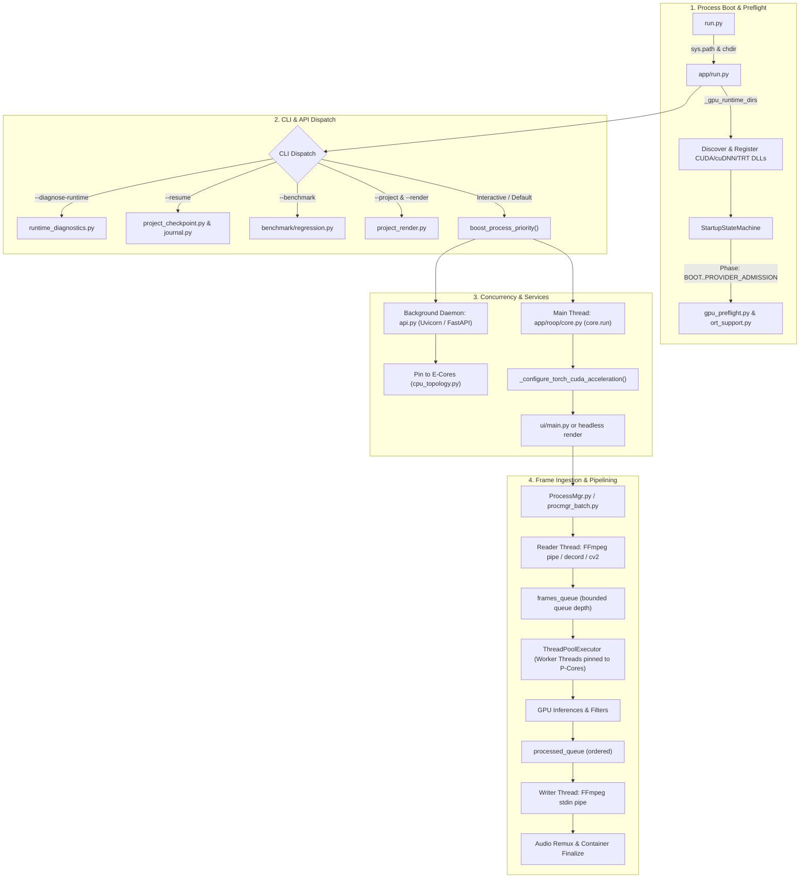
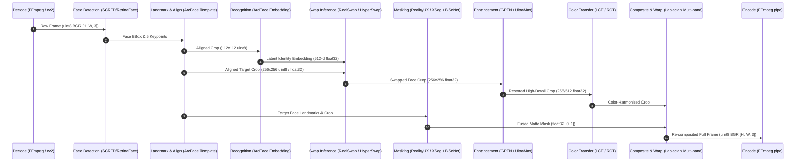

# Roop Ultimate — End-to-End Pipeline Architectural Blueprint & Code Map

> **Audit Document**: `.audit/01_pipeline_map.md`  
> **Repository**: `roop-ultimate`  
> **Single Source of Truth**: [AGENTS.md](file:///G:/pinokio/api/roop-ultimate/AGENTS.md)  
> **Policies**: [PRECISION_POLICY.md](file:///G:/pinokio/api/roop-ultimate/PRECISION_POLICY.md), [CUDA_EXECUTION_POLICY.md](file:///G:/pinokio/api/roop-ultimate/CUDA_EXECUTION_POLICY.md), [PERFORMANCE_BASELINE.md](file:///G:/pinokio/api/roop-ultimate/PERFORMANCE_BASELINE.md)  
> **Status**: Verified against codebase

---

## Executive Summary & Hardware Execution Profiles

Roop Ultimate is an enterprise-grade, high-throughput facial transformation and restoration pipeline optimized for real-time and production batch processing. The engine operates across a strict dual-device execution contract designed to prevent resource exhaustion and numerical instability:

1. **Main Device (Desktop Workstation — Ada Lovelace)**:
   - **GPU**: NVIDIA GeForce RTX 4070 Desktop (12.0 GB VRAM, 200W TDP, PCIe 4.0 x16).
   - **Host Specs**: 24 Physical Cores / 32 Logical Threads, 31.7 GB physical RAM.
   - **VRAM Tier**: `11.5–15.5 GB` (`perf_trt_pool: 2`, `perf_detmask_pool: 2`, `perf_detector_pool: 2`).
   - **Optimal Budget**: ~9.07 GB VRAM allocated, ~3.0 GB unfragmented headroom (100% on-device VRAM, zero PCIe paging thrash).
   - **Stabilization**: Parallel chunked execution (`hard_cap: 4096 MB`), 12-thread execution, automatic 2-round work stealing.
   - **Precision**: Mixed TensorRT precision enabled (+20% throughput over FP32 baseline) guarded by automated canary and displacement outcome gates.

2. **Secondary Device (Laptop Workstation — Ampere Mobile)**:
   - **GPU**: NVIDIA GeForce RTX 3060 Laptop GPU (6.0 GB VRAM, mobile TDP).
   - **Host Specs**: 16 GB physical RAM.
   - **VRAM Tier**: `< 7 GB` (`0 / 0` single context + global GPU guard lock to prevent out-of-memory errors).
   - **Stabilization**: Adaptive block sizing (`adaptive_block = max(2 * wu, 16)`), keeping process RSS strictly below 2.5 GB.
   - **Precision**: TensorRT engine generation is disabled; operates exclusively via `CUDAExecutionProvider` FP32 / FP16 fallback to prevent VRAM paging thrash.
   - **Aesthetics**: Look settings diverge deliberately (tuned for GPEN 256 Pro: `blend_ratio: 0.85`, `face_mask_blend: 25`, `merger_sharpen: 0.55`, `stabilize_enhancer_strength: 0.6`).

---

## 1. Entry Points & Orchestration Architecture



### 1.1 CLI Execution Path & Lifecycle

- **Root Forwarder**: [run.py](file:///G:/pinokio/api/roop-ultimate/run.py#L1-L17)
  - Hardcodes `os.environ["PYTORCH_CUDA_ALLOC_CONF"] = "expandable_segments:False,max_split_size_mb:128"` before importing torch to eliminate PyTorch memory fragmentation.
  - Inserts `app/` into `sys.path[0]`, changes current working directory to `app/`, and executes `app/run.py` via `runpy.run_path(..., run_name="__main__")`.
- **Preflight & Hardware Admission**: [run.py](file:///G:/pinokio/api/roop-ultimate/app/run.py#L21-L105)
  - `_gpu_runtime_dirs()` / `_register_gpu_runtime_dirs()` ([run.py#L21-L82](file:///G:/pinokio/api/roop-ultimate/app/run.py#L21-L82)): Searches `torch/lib`, `tensorrt_libs`, `tensorrt`, and `nvidia/*/bin` (`cuda_runtime`, `cublas`, `cudnn`, `curand`, `cufft`). Calls `os.add_dll_directory()` and prepends directories to `os.environ["PATH"]` so both Python C-extensions and ONNX Runtime provider DLLs resolve without dynamic linker failures.
  - `run_preflight_checks()` ([run.py#L86-L105](file:///G:/pinokio/api/roop-ultimate/app/run.py#L86-L105)): Executes the `StartupStateMachine` through phases:
    1. `StartupPhase.BOOT`: Environment sanity.
    2. `StartupPhase.DEPENDENCY_PREFLIGHT`: Dependency integrity checks.
    3. `StartupPhase.DLL_RUNTIME_PREFLIGHT`: CUDA runtime DLL resolution.
    4. `StartupPhase.ORT_PREFLIGHT`: Provider validation (`onnxruntime-gpu`).
    5. `StartupPhase.GPU_PREFLIGHT`: Device VRAM, driver version, compute capability.
    6. `StartupPhase.PROVIDER_ADMISSION`: Hardware profile admission.
  - Runtime Profile Seeding ([run.py#L128-L178](file:///G:/pinokio/api/roop-ultimate/app/run.py#L128-L178)): Loads `config.yaml`, queries `RuntimeOptimizer.startup_profile()`, and executes `settings.apply_env(cfg, os.environ)` to export `ROOP_*` environment variables prior to heavy pipeline imports.
  - Hybrid CPU Topology ([run.py#L181-L189](file:///G:/pinokio/api/roop-ultimate/app/run.py#L181-L189)): Queries [cpu_topology.py](file:///G:/pinokio/api/roop-ultimate/app/roop/core/cpu_topology.py) to identify Intel Performance Cores (P-Cores) and Efficient Cores (E-Cores).
  - Windows Socket Compatibility ([run.py#L195-L196](file:///G:/pinokio/api/roop-ultimate/app/run.py#L195-L196)): Installs `roop.win_asyncio_compat.install()` to prevent `ProactorEventLoop` crashes triggered by abrupt TCP resets.
- **CLI Argument Dispatch**: [run.py#L201-L434](file:///G:/pinokio/api/roop-ultimate/app/run.py#L201-L434)
  - Supports `--cuda_device_id`, `--execution-provider`, `--execution-batch-size`, `--source`, `--resume`, `--project`, `--render`, `--output`, `--export-fcpxml`, `--export-edl`, `--scene-detect`, `--benchmark`, `--benchmark-mode`, `--ui`, `--react`, `--diagnose-runtime`.
  - Normalizes provider names to ONNX conventions (`TensorrtExecutionProvider`, `CUDAExecutionProvider`, `CPUExecutionProvider`).
  - Execution Branches:
    - `--diagnose-runtime`: Invokes `roop.runtime_diagnostics.run_diagnose_runtime()` and exits.
    - `--resume`: Dispatches to `project_checkpoint.load()` and `roop.journal.verify_and_recover_segments()`.
    - `--benchmark`: Runs `roop.benchmark.regression.run_regression_from_args()` or `roop.benchmark.ui_dashboard.run_cli_benchmark()`.
    - `--project` with `--render`: Dispatches to headless batch execution via `roop.project_render.run_project_cli(args, CFG)`.
    - Default / Interactive: Elevates Windows scheduling priority via `roop.keep_awake.boost_process_priority()`, launches API server on a background daemon thread `threading.Thread(target=run_api, daemon=True)`, and hands main thread to `core.run()`.
- **Core Engine Lifecycle**: [core.py](file:///G:/pinokio/api/roop-ultimate/app/roop/core.py#L35-L2305)
  - `_configure_torch_cuda_acceleration()` ([core.py#L35-L71](file:///G:/pinokio/api/roop-ultimate/app/roop/core.py#L35-L71)): On GPUs with compute capability $\ge (8, 0)$ (Ampere+) and VRAM $\ge 10\text{ GB}$, enables TF32 for PyTorch matmul (`torch.backends.cuda.matmul.allow_tf32 = True`) and cuDNN convolutions (`torch.backends.cudnn.allow_tf32 = True`). Explicitly forces `torch.backends.cudnn.benchmark = False` because benchmark autotuning incurs 456 ms/call overhead on dynamic facial bounding box ROIs and causes non-deterministic algorithm selection across worker threads.
  - `parse_args()` ([core.py#L134-L204](file:///G:/pinokio/api/roop-ultimate/app/roop/core.py#L134-L204)): Sets OS signal handlers (`SIGINT` -> `destroy()`), installs Windows console close handler via `install_console_close_handler()`, and parses arguments into `roop.globals.startup_args`.
  - `core.run()` ([core.py#L2248-L2305](file:///G:/pinokio/api/roop-ultimate/app/roop/core.py#L2248-L2305)): Executes `StartupPhase.CONFIG_LOAD`, initializes `roop.globals.CFG = apply_provider_override(Settings('config.yaml'))`, imports source gallery references (`source_gallery.add_reference_folder`), prints banner, and invokes `ui.main.run()`.

### 1.2 UI & API Execution Path (FastAPI & Job Dispatch)

- **FastAPI Infrastructure**: [api.py](file:///G:/pinokio/api/roop-ultimate/app/api.py#L31-L125)
  - Instantiates `app = FastAPI()`, configures `CORSMiddleware`, and registers functional sub-routers (`routes_telemetry`, `routes_autotune`, `routes_queue`, etc.).
  - Static Frontend Mount ([api.py#L7268-L7310](file:///G:/pinokio/api/roop-ultimate/app/api.py#L7268-L7310)): Serves compiled React SPA from `react-ui/dist` with custom fallback 404 handler for HTML5 history API navigation, eliminating route collisions.
  - Server Bootstrap ([api.py#L7518-L7541](file:///G:/pinokio/api/roop-ultimate/app/api.py#L7518-L7541)): Binds thread to E-Cores via `core.cpu_topology.pin_current_thread_to_e_cores()`, reads port from `ROOP_API_PORT` (default 8001), and starts `uvicorn.run(app, host=policy.host, port=port)`.
  - Server Lifespan ([api.py#L7242-L7264](file:///G:/pinokio/api/roop-ultimate/app/api.py#L7242-L7264)): Manages telemetry hub lifecycle over the asyncio loop.
- **REST & WebSocket Route Catalog**:
  - Configuration: `GET /api/settings`, `POST /api/settings` ([api.py#L1444, L1518](file:///G:/pinokio/api/roop-ultimate/app/api.py#L1444)) for live read/write and hot-reload without restart.
  - State & Capabilities: `GET /api/state`, `GET /api/meta` ([api.py#L1879, L2067](file:///G:/pinokio/api/roop-ultimate/app/api.py#L1879)) for active engine status, memory utilization, and admitted models.
  - Source Gallery: `POST /api/source/add` (L2109), `add-folder` (L2159), `select` (L2212), `remove` (L2192), `clear` (L2206).
  - Target Media: `POST /api/target/select` (L2242), `clear` (L2305), `extract-audio` (L2354).
  - Processing Control: `POST /api/process/start` (L2780), `stop` (L2897), `pause` (L2919), `resume` (L2941), `status` (L2963).
  - Frame Preview: `GET /api/preview/frame` (L3048), `extract-frame` (L3145).
  - Job Queue Management: `GET /api/queue` (L3210), `POST /api/queue/add` (L3245), `POST /api/queue/cancel` (L3298).
  - Hardware Diagnostics & Tuning: `GET /api/autotune/status` (L3410), `POST /api/autotune/run` (L3452).
  - Telemetry: `GET /api/telemetry/events` (L3610) WebSocket for real-time FPS, stage latencies, VRAM, and face counts.

### 1.3 Video Decoding & Ingestion

- **Extraction Backends**:
  1. *Piped FFmpeg In-Memory Streaming*: [ProcessMgr.py#L1743-L1880](file:///G:/pinokio/api/roop-ultimate/app/roop/ProcessMgr.py#L1743-L1880) (`read_frames_thread`). Invokes FFmpeg subprocess outputting raw BGR24 (`-f rawvideo -pix_fmt bgr24 pipe:1`). Decodes directly into pre-allocated NumPy array buffers via `sys.stdin.buffer.read(frame_size)`, eliminating disk I/O bottlenecks.
  2. *Temp Disk Frame Extraction*: [core.py#L235-L310](file:///G:/pinokio/api/roop-ultimate/app/roop/core.py#L235-L310) (`extract_frames`). Used as fallback when random seeking is required; dumps frames to disk temp folder via FFmpeg image sequences.
  3. *Random Seeking / Pre-Pass*: [procmgr_tracking.py#L2574-L2650](file:///G:/pinokio/api/roop-ultimate/app/roop/procmgr_tracking.py#L2574-L2650) utilizes OpenCV `cv2.VideoCapture` or `decord.VideoReader` with GPU hardware decode acceleration.
- **Aspect Ratio & Timebase Preservation**:
  - Sample Aspect Ratio (SAR) is probed via FFprobe and bound to `roop.globals.video_sar` ([ProcessMgr.py#L1250-L1275](file:///G:/pinokio/api/roop-ultimate/app/roop/ProcessMgr.py#L1250-L1275)) to correct non-square pixel footage (e.g. anamorphic PAL 16:15).
  - Native frame rate (`video_fps`) and exact frame count (`total_frames`) are validated to preserve A/V synchrony.

### 1.4 Video Encoding, Audio Remuxing & Frame Write-Out

- **Frame Retirement & Writer Thread**: [ProcessMgr.py#L1991-L2070](file:///G:/pinokio/api/roop-ultimate/app/roop/ProcessMgr.py#L1991-L2070) (`write_frames_thread`).
  - Worker threads retire completed frames out-of-order into a min-heap or indexed slot ring buffer.
  - Writer thread extracts frames sequentially (`frame_idx = 0, 1, 2, ...`) and streams raw bytes to the FFmpeg stdin pipe.
- **FFmpeg Encoding Subprocess**: [ProcessMgr.py#L2100-L2240](file:///G:/pinokio/api/roop-ultimate/app/roop/ProcessMgr.py#L2100-L2240) (`build_ffmpeg_cli`).
  - Codec dispatch based on `output_video_codec`:
    - `libx264`: `-c:v libx264 -preset medium -crf <video_quality> -pix_fmt yuv420p`.
    - `hevc_nvenc` / `h264_nvenc`: Hardware-accelerated GPU NVENC encoding with low latency and minimal CPU overhead.
- **Audio Preservation & Final Muxing**: [core.py#L420-L490](file:///G:/pinokio/api/roop-ultimate/app/roop/core.py#L420-L490) (`restore_audio`).
  - Strips audio track from source video during initialization to temp container via `-vn -acodec copy`.
  - Upon video write completion, FFmpeg remuxes audio into the final target container using copy mode `-c:a copy` or re-encodes via AAC `-c:a aac -b:a 192k` if container formats differ, synchronizing PTS/DTS timestamps.

### 1.5 Multi-Threading, Queues, Schedulers & Temporal Smoothing

- **Worker Thread Model & Affinity**: [procmgr_batch.py#L1180-L1220](file:///G:/pinokio/api/roop-ultimate/app/roop/procmgr_batch.py#L1180-L1220) & [ProcessMgr.py](file:///G:/pinokio/api/roop-ultimate/app/roop/ProcessMgr.py).
  - Worker thread pool size is calculated via `CFG.resolve_threads(mode)` based on host CPU core topology and GPU VRAM budget.
  - Workers in `ThreadPoolExecutor` are explicitly pinned to Intel Performance Cores (P-Cores) via initializer `core.cpu_topology.pin_current_thread_to_p_cores` ([procmgr_batch.py#L1186](file:///G:/pinokio/api/roop-ultimate/app/roop/procmgr_batch.py#L1186)).
  - Bounded Memory Backpressure: Frames are distributed across worker queues `self.frames_queue[i]` bounded by `frame_capped_queue_depth(qdepth, threads)` ([procmgr_batch.py#L14](file:///G:/pinokio/api/roop-ultimate/app/roop/procmgr_batch.py#L14)), guaranteeing total in-flight frames remain $\le$ `ROOP_MAX_FRAMES_IN_FLIGHT` (default 64) to prevent system RAM bloat.
- **Unified Runtime Scheduler**: [unified_runtime_scheduler.py#L266-L450](file:///G:/pinokio/api/roop-ultimate/app/roop/unified_runtime_scheduler.py#L266-L450).
  - Coordinates pipelined decode, single-worker GPU inference (`_inference_workers = 1`), and encode ([ProcessMgr.py#L2077](file:///G:/pinokio/api/roop-ultimate/app/roop/ProcessMgr.py#L2077)).
  - Enforces strict memory budgets ($\le 4$ frames in flight) and profiles stage latencies (decode, preprocess, inference, postprocess, encode).
- **Cross-Frame Swap Batching**: [swap_batcher.py](file:///G:/pinokio/api/roop-ultimate/app/roop/swap_batcher.py) & [ProcessMgr.py#L2252](file:///G:/pinokio/api/roop-ultimate/app/roop/ProcessMgr.py#L2252) (`_make_swap_batcher`).
  - Active when `ROOP_BATCH_SWAP=1` and `ROOP_BATCH_SWAP_XFRAME=1`.
  - Coalesces face swap requests from multiple worker threads into batched GPU forward passes (`FaceSwapInsightFace.RunBatchMulti`), bounded by `ROOP_BATCH_SWAP_MAX` (B=8 for RTX 4070 12GB; capped to 2-4 or 1 on RTX 3060 Laptop tier by `vram_governor.governed_batch_cap`), with timeout `ROOP_BATCH_SWAP_WAIT_MS` (default 4.0ms).
- **Stabilizer Scheduling Architecture**:
  - *Sequential Mode*: Fallback when non-causal smoothing filters cannot be split into independent windows.
  - *2-Pass Mode (`use_2pass`)*: Pass 1 precomputes smoothed keypoints sequentially via `_precompute_stabilized_kps()` ([procmgr_tracking.py#L3769](file:///G:/pinokio/api/roop-ultimate/app/roop/procmgr_tracking.py#L3769)); Pass 2 executes parallel swaps using precomputed trajectory caches.
  - *Parallel Stabilization (`_run_stab_parallel`)*: [ProcessMgr.py#L2355-L2510](file:///G:/pinokio/api/roop-ultimate/app/roop/ProcessMgr.py#L2355-L2510).
    - Partition geometry computed via `_stab_parallel_geometry(threads)`: warm-up frames `WU` derived from filter cutoffs, contiguous block size `block = 3 * WU`, worker count `stab_width`, and `blocks_per_chunk`.
    - Dedicated reader thread decodes chunks into RAM bounded by `ROOP_STAB_CHUNK_MB` (`_default_stab_chunk_mb = available_ram * 0.40 / 6`).
    - Workers execute sub-blocks in parallel using thread-local filter instances (`_kps_stab_factory`, `_enh_stab_factory`, `_mask_stab_factory`).
    - Seam-Free Continuity: Warm-up frames overlap block boundaries to prime internal filter states before recording output frames.
    - Warm-up Deduplication: `_stab_dedup_plan()` ([ProcessMgr.py#L2418](file:///G:/pinokio/api/roop-ultimate/app/roop/ProcessMgr.py#L2418)) shares raw inference results across overlap frames between adjacent blocks.
  - *Continuous Streaming FIFO*: `StreamingStabilizationHistory` ([one_euro.py#L37](file:///G:/pinokio/api/roop-ultimate/app/roop/one_euro.py#L37)) maintains rolling history across scene cuts for zero warm-up recompute in unified scheduler mode.
- **Temporal Smoothing Filters & Tracking Pre-Pass**:
  - 1-Euro & Kalman Filters: `OneEuroFilter` ([one_euro.py#L273](file:///G:/pinokio/api/roop-ultimate/app/roop/one_euro.py#L273)), `KpsStabilizer` (L306), `KalmanKpsStabilizer` (L395), `EmaKpsStabilizer` (L490).
  - Landmark Smoothing: `AdaptiveLandmarkSmoother` ([temporal_smoother.py#L149](file:///G:/pinokio/api/roop-ultimate/app/roop/temporal_smoother.py#L149)) dynamically modulates velocity parameter $\beta$; `ZeroPhaseTrackSmoother` (L446) executes forward-backward non-causal zero-phase filtering across full track spans.
  - Texture & Optical Flow Stabilization: `EnhancerStabilizer` ([one_euro.py#L534](file:///G:/pinokio/api/roop-ultimate/app/roop/one_euro.py#L534)) performs motion-adaptive crop blending; `HighFrequencyFlowStabilizer` ([temporal_smoother.py#L782](file:///G:/pinokio/api/roop-ultimate/app/roop/temporal_smoother.py#L782)) combines Farneback/RAFT optical flow motion compensation with temporal bilateral filtering.
  - Mask Stabilization: `MaskStabilizer` ([one_euro.py#L619](file:///G:/pinokio/api/roop-ultimate/app/roop/one_euro.py#L619)) with optional optical flow warp (`flow_warp=True`).
  - Temporal Face Tracker: `TemporalFaceTracker` ([temporal_tracker.py#L198](file:///G:/pinokio/api/roop-ultimate/app/roop/temporal_tracker.py#L198)) & `_precompute_temporal()` ([procmgr_tracking.py#L2574](file:///G:/pinokio/api/roop-ultimate/app/roop/procmgr_tracking.py#L2574)) track identities across frames, gap-fill missed detections, and build trajectory plans (`_build_temporal_faces`, L3091).

---

## 2. Stage-by-Stage Code Map



---

### Stage 0: Video Decoding & Ingestion
- **Implementation Sites**:
  - Pipelined streaming: [ProcessMgr.py#L1743-L1880](file:///G:/pinokio/api/roop-ultimate/app/roop/ProcessMgr.py#L1743-L1880) (`read_frames_thread`)
  - Subprocess command construction: [core.py#L235-L310](file:///G:/pinokio/api/roop-ultimate/app/roop/core.py#L235-L310)
  - SAR & Metadata extraction: [ProcessMgr.py#L1250-L1275](file:///G:/pinokio/api/roop-ultimate/app/roop/ProcessMgr.py#L1250-L1275)
- **Input**: Source video container file (e.g., MP4, MKV, MOV).
- **Output**: Uncompressed frame tuple `(frame_idx, frame_data)` where `frame_data` is a contiguous `np.ndarray` of type `np.uint8`, shape `(H, W, 3)` in BGR order.
- **Transformation Details**:
  - Piped standard output reading via FFmpeg: `ffmpeg -v error -i <input> -f rawvideo -pix_fmt bgr24 pipe:1`.
  - Probes Sample Aspect Ratio (SAR). If $SAR \ne 1.0$, binds ratio to `roop.globals.video_sar` for non-square pixel correction.
  - Frames are inserted round-robin into bounded worker queues `frames_queue[i]`.

---

### Stage 1: Face Detection & Orientation Resolution
- **Implementation Sites**:
  - Engine builder & hybrid dispatch: [face_util.py#L79-L87, L246-L303, L1035-L1110](file:///G:/pinokio/api/roop-ultimate/app/roop/face_util.py#L79)
  - RetinaFace engine: [retinaface.py#L120-L210](file:///G:/pinokio/api/roop-ultimate/app/roop/retinaface.py#L120-L210)
  - YuNet engine: [yunet.py#L26-L139](file:///G:/pinokio/api/roop-ultimate/app/roop/yunet.py#L26-L139)
  - YOLOFace engine: [yoloface.py#L51-L170](file:///G:/pinokio/api/roop-ultimate/app/roop/yoloface.py#L51-L170)
  - Multi-Scale Scale Pyramid & DIoU NMS: [face_detector.py#L60-L437](file:///G:/pinokio/api/roop-ultimate/app/roop/face_detector.py#L60-L437)
  - Rotation primitives & Down-Axis: [face_util.py#L2431-L2604](file:///G:/pinokio/api/roop-ultimate/app/roop/face_util.py#L2431-L2604)
- **Input**: `frame` (`np.ndarray`, `uint8`, `[H, W, 3]`, BGR).
- **Output**: List of detected `Face` objects containing bounding box `bbox` (`[x1, y1, x2, y2]`), detection score `det_score` (`float`), and raw 5 primary keypoints `kps` (`np.ndarray`, `float32`, `[5, 2]`).
- **Transformation Details**:
  - *Hybrid Engine Hierarchy*:
    1. `SCRFD` (`det_10g.onnx`): Anchor-free distance regression detector from InsightFace `buffalo_l`. Input resolution clamped to 640x640 via `_desired_det_size()`.
    2. `RetinaFace R50` (`retinaface_r50.onnx`): ResNet-50 anchor pyramid (`steps=(8, 16, 32)`, `min_sizes=((16, 32), (64, 128), (256, 512))`, `variance=(0.1, 0.2)`). Preprocessing applies mean subtraction `(104.0, 117.0, 123.0)` without std scaling.
    3. `YuNet` (`face_detection_yunet_2023mar.onnx`): Thread-safe pool of OpenCV `FaceDetectorYN` instances.
    4. `YOLOFace` (`yoloface_8n.onnx`): Ultralytics YOLOv8-nano face model with input `(1, 3, 640, 640)` scaled via `(canvas - 127.5) / 128.0`.
  - *Multi-Scale Dynamic Pyramid*: Triggered when face height > 500px or coverage > 75%; executes multi-scale passes `[0.5, 0.75, 1.0]` and unifies boxes via Distance-IoU NMS:
    $$DIoU = IoU - \frac{\rho^2(b, b^{gt})}{c^2}$$
  - *In-Plane Roll & Orientation Resolution*:
    - Computes head down-axis via 3D-68 landmarks (`pts[36:42]` and `pts[42:48]` mid-eye to `(pts[48]+pts[54])/2.0` mouth-center) or 5-kps midline.
    - If roll exceeds threshold ($54.5^\circ$), rotates image by 90°, 180°, or 270° via `np.rot90`, runs detection, and un-rotates coordinates via `_unrotate_face_coords`.
    - Merged junction detection drops touching/kissing faces if their overlap exceeds distance bounds.

---

### Stage 2: Landmark Extraction & Geometric Alignment
- **Implementation Sites**:
  - Coordinate templates & `swap_template_points`: [face_util.py#L3440-L3475](file:///G:/pinokio/api/roop-ultimate/app/roop/face_util.py#L3440-L3475)
  - `estimate_norm` & Similarity Transform: [face_util.py#L3477-L3513](file:///G:/pinokio/api/roop-ultimate/app/roop/face_util.py#L3477-L3513)
  - `align_crop` with edge replication: [face_util.py#L3517-L3543](file:///G:/pinokio/api/roop-ultimate/app/roop/face_util.py#L3517-L3543)
  - Landmark extraction models (2D-106, 3D-68): [face_util.py#L1393-L1435, L2113](file:///G:/pinokio/api/roop-ultimate/app/roop/face_util.py#L1393)
  - Geometric sanity validation: [geometric_alignment.py#L64-L130](file:///G:/pinokio/api/roop-ultimate/app/roop/geometric_alignment.py#L64-L130)
- **Input**: `frame` (`np.ndarray`, `uint8`), `Face` object with 5 keypoints `kps` (`[5, 2]`).
- **Output**: Aligned face crop `crop` (`np.ndarray`, `uint8`, shape `[S, S, 3]`), $2 \times 3$ affine transform matrix `M` (`np.ndarray`, `float64`), high-density 2D-106 landmarks (`[106, 2]`), and 3D-68 landmarks (`[68, 3]`).
- **Transformation Details**:
  - *Kinematic & Geometric Sanity Gates*:
    - Interocular distance (IOD): $\lVert \text{eye}_{left} - \text{eye}_{right} \rVert_2 \ge 3.0\text{ px}$.
    - Eye-mouth distance: $\lVert \text{eye}_{mid} - \text{mouth}_{mid} \rVert_2 \ge 3.0\text{ px}$.
    - Affine condition number: $\sigma_{max} / \sigma_{min} \le 1.15$ (rejects non-rigid shearing).
    - Singular value scale range: $\sigma \in [0.005, 150.0]$.
  - *On-Demand 3D-68 Landmark Probing*:
    - 3D-68 landmark model (`1k3d68.onnx`) costs 2.23 ms/face (19% detection throughput). It is kept out of the routine loop and activated dynamically only when keypoint roll angle $\ge 20^\circ$ (`ROOP_LM68_ARM_DEG`), or periodically every 12th detection (`ROOP_LM68_PROBE`) to catch scene cuts to inverted heads, holding for 90 detections (`ROOP_LM68_HOLD`).
  - *Similarity Transform & SAR Compensation*:
    - Non-uniform Affine Transform is **strictly rejected** (`use_affine = False` in `estimate_norm`); uses Umeyama `skimage.transform.SimilarityTransform` to preserve natural facial aspect ratio.
    - Non-square pixel correction: If $|SAR - 1.0| > 0.005$, landmark $x$-coordinates are scaled by SAR to compute similarity in physical display space, then transformed back to raster space:
      $$M_{pixel}[:, 0] = M_{display}[:, 0] \cdot SAR$$
  - *Edge Replication (`BORDER_REPLICATE`)*:
    - `align_crop` warps the face using `cv2.warpAffine` with `borderMode=cv2.BORDER_REPLICATE` and `flags=cv2.INTER_CUBIC`. This eliminates the solid black wedge border artifact generated by `BORDER_CONSTANT`, keeping edge pixels in-distribution for neural network inputs.

---

### Stage 3: Face Recognition & Identity Matching
- **Implementation Sites**:
  - Auxiliary analyser pool & ArcFace: [face_util.py#L246-L303](file:///G:/pinokio/api/roop-ultimate/app/roop/face_util.py#L246-L303)
  - Recognition & distance matching: [face_analyser.py#L790-L860](file:///G:/pinokio/api/roop-ultimate/app/roop/face_analyser.py#L790-L860)
  - Multi-shot gallery reference & hysteresis: [face_reference.py#L20-L85](file:///G:/pinokio/api/roop-ultimate/app/roop/face_reference.py#L20-L85)
  - AdaFace recognizer: [recognizer_adaface.py#L40-L110](file:///G:/pinokio/api/roop-ultimate/app/roop/recognizer_adaface.py#L40-L110)
  - Identity Lock state machine: [identity_lock.py#L40-L120](file:///G:/pinokio/api/roop-ultimate/app/roop/identity_lock.py#L40-L120)
- **Input**: Aligned crop `(112, 112, 3)` or detected face.
- **Output**: 512-dimensional normalized embedding `embedding` (`np.ndarray`, `float32`, shape `[512]`, $\lVert v \rVert_2 = 1.0$), and identity match assignment (`bool`).
- **Transformation Details**:
  - *Embedding Extraction*: ArcFace ResNet-50 (`w600k_r50.onnx`) or AdaFace extract feature vectors. Vectors are $L_2$-normalized:
    $$\hat{v} = \frac{v}{\lVert v \rVert_2}$$
  - *Distance Formulation*:
    $$D_{cos}(u, v) = 1.0 - \frac{u \cdot v}{\lVert u \rVert_2 \lVert v \rVert_2}$$
  - *Dual-Threshold Hysteresis Matching*:
    - High Acceptance Threshold: Cosine similarity $\ge 0.62$ ($D_{cos} \le 0.38$) matches unconditionally.
    - Low Tracking Threshold: Cosine similarity $\ge 0.50$ ($D_{cos} \le 0.50$) accepted only if spatial bounding box IoU with previous track $\ge 0.50$.
    - Crossing IoU Gate: $IoU \ge 0.30$ triggers identity swap disambiguation.
  - *Multi-Shot Gallery Aggregation*: Computes normalized centroid of selected reference embeddings; enforces minimum cosine similarity `DEFAULT_MIN_COSINE = 0.65`.
  - *Identity Lock State Machine*:
    - Enforces temporal commitment: `margin = 0.08`, `hold = 3` frames, `settle = 3` frames, `release = 2` frames, `traj_iou = 0.45`, `traj_bonus = 0.10`, `max_gap = 6` frames, `max_defend = 12` frames. Prevents identity flicker during rapid head turns.

---

### Stage 4: Face Swap Inference
- **Implementation Sites**:
  - Swapper coordinator & batch runner: [FaceSwapInsightFace.py#L380-L1560](file:///G:/pinokio/api/roop-ultimate/app/roop/processors/FaceSwapInsightFace.py#L380-L1560)
  - Swapper base & crop preparation: [face_swapper.py](file:///G:/pinokio/api/roop-ultimate/app/roop/processors/frame/face_swapper.py)
  - Backend manager & session factory: [backend_manager.py#L35-L120](file:///G:/pinokio/api/roop-ultimate/app/roop/backend_manager.py#L35-L120)
  - Persistent CUDA I/O Binding: [utilities.py#L41-L161](file:///G:/pinokio/api/roop-ultimate/app/roop/utilities.py#L41-L161) (`CudaOrtIOBinding`)
  - Swap Canary verification: [swap_canary.py#L40-L110](file:///G:/pinokio/api/roop-ultimate/app/roop/swap_canary.py#L40-L110)
  - Precision policy & overrides: [precision_policy.py#L450-L490](file:///G:/pinokio/api/roop-ultimate/app/roop/precision_policy.py#L450-L490)
- **Input**:
  - Target face crop: `np.ndarray`, shape `(B, 3, S, S)`, normalized float32.
  - Source identity latent: `(B, 512)` float32 embedding or normalized emap.
- **Output**:
  - Swapped face crop: `np.ndarray`, shape `(B, 3, S, S)`, float32 or uint8.
  - Soft mask matte (for HyperSwap and HiFiFace): shape `(B, 1, S, S)`, float32.
- **Transformation Details**:
  - *Model Parameter Matrix*:
    - `inswapper_128`: Crop 128x128; template `arcface`; input norm $[0, 0, 0] / [1, 1, 1]$; embedding `normed_emap` via `emap.npy`.
    - `hyperswap_1a_256`: Crop 256x256; template `arcface`; input norm $[0.5, 0.5, 0.5] / [0.5, 0.5, 0.5]$ (range $[-1, 1]$); embedding `normed` ArcFace; outputs swapped crop and native soft matte.
    - `hififace`: Crop 256x256; template `mtcnn_512`; input norm $[0.5, 0.5, 0.5] / [0.5, 0.5, 0.5]$; embedding converted via `crossface_hififace.onnx`.
    - `simswap_256`: Crop 256x256; template `arcface_112_v1`; ImageNet normalization; embedding converted via `crossface_simswap.onnx`.
    - `realswap` (Live Default): Dual-model composite. Runs primary swap with `hyperswap_1a_256`; runs secondary swap with `hififace`; warps secondary output into primary coordinate space; mixes eyelid/eyelash band via `_mix_outputs` ([FaceSwapInsightFace.py#L2072-L2082](file:///G:/pinokio/api/roop-ultimate/app/roop/processors/FaceSwapInsightFace.py#L2072-L2082)) for enhanced gaze fidelity.
  - *Inference Providers & Dynamic TRT Recovery*:
    - Provider hierarchy: `TensorrtExecutionProvider` $\to$ `CUDAExecutionProvider` $\to$ `CPUExecutionProvider`.
    - Dynamic TRT Recovery ([FaceSwapInsightFace.py#L1270-L1307](file:///G:/pinokio/api/roop-ultimate/app/roop/processors/FaceSwapInsightFace.py#L1270-L1307)): If TensorRT encounters shape violation or tactic failure, automatically unloads engine and steps down to `CUDAExecutionProvider` without failing the frame or dropping in-flight batches.
  - *Persistent CUDA I/O Binding (`CudaOrtIOBinding`)*:
    - Pre-allocates fixed device buffers on `cuda:device_id`.
    - Binds pointers via `binding.bind_input` and `binding.bind_output`.
    - Executes `session.run_with_iobinding(binding)`, eliminating Host-to-Device and Device-to-Host memory copies across consecutive pipeline stages.
  - *Precision Rules & Outcome Guard*:
    - Pure FP16 for swappers is **forbidden** due to activation overflow producing rainbow smudge artifacts.
    - Mixed precision is permitted on Ada Lovelace (RTX 4070) guarded by `verify_swap` displacement tolerance (`verify_tol_for`: 0.65 for HiFiFace, 0.79 for HyperSwap). If output landmarks displace beyond tolerance, output is discarded and re-computed via FP32 fallback.

---

### Stage 5: Occlusion & Face Parsing Mask Generation
- **Implementation Sites**:
  - Composite mask engine: [mask_engine.py#L50-L294](file:///G:/pinokio/api/roop-ultimate/app/roop/processors/frame/mask_engine.py#L50-L294) (`generate_composite_mask`)
  - RealityUX flagship engine: [Mask_RealityUX.py#L1-L536](file:///G:/pinokio/api/roop-ultimate/app/roop/processors/Mask_RealityUX.py#L1-L536)
  - BiSeNet Face Parser: [Mask_FaceParser.py#L1-L332](file:///G:/pinokio/api/roop-ultimate/app/roop/processors/Mask_FaceParser.py#L1-L332)
  - Standalone XSeg / XSeg3 / Occluder: [Mask_XSeg.py](file:///G:/pinokio/api/roop-ultimate/app/roop/processors/Mask_XSeg.py), [Mask_XSeg3.py](file:///G:/pinokio/api/roop-ultimate/app/roop/processors/Mask_XSeg3.py), [Mask_Occluder.py](file:///G:/pinokio/api/roop-ultimate/app/roop/processors/Mask_Occluder.py)
  - Occlusion injection & flow warp: [occlusion_mask.py#L32-L148](file:///G:/pinokio/api/roop-ultimate/app/roop/occlusion_mask.py#L32-L148)
- **Input**: Aligned target face crop `(S, S, 3)`, 68/106 landmarks, and tracking metadata.
- **Output**: High-precision 2D alpha matte `mask` (`np.ndarray`, `float32`, shape `[S, S]`, values in range $[0.0, 1.0]$ where $1.0 = \text{swapped pixel}$, $0.0 = \text{original target pixel}$).
- **Transformation Details**:
  - *Composite Formula*:
    $$\text{Mask}_{composite} = \text{Box} \times \text{Hull} \times \text{Occluder} \times \text{Parser} \times \text{ModelMask}$$
  - *Convex Hull with Forehead Elevation*:
    - Computes convex hull over 68 facial landmark points.
    - Elevates top forehead points by $\Delta y = \text{forehead} \times \text{height}$ (default 0.25) to cover forehead regions above the eyebrows.
    - Rasterized via NumPy half-plane polygon filling or GPU PyTorch tensor operations (`_hull_mask_torch`).
  - *RealityUX Fused Engine*:
    - Blends DFL XSeg segmentation with BiSeNet 19-class Face Parsing.
    - Non-Face Subtraction: Class IDs 7, 8, 9, 16, 17, 18 (ears, cloth, hair, hat) are marked opaque target. Background (0) and neck (14, 15) are preserved to prevent cutoffs.
    - Gated Accessory Subtraction:
      $$\text{allowed} = \text{clip}\left(\frac{\text{XSeg} - 0.05}{0.20}, 0.0, 1.0\right), \quad \text{non\_face} = \text{clip}(\text{is\_accessory} \times \text{allowed}, 0.0, 1.0)$$
    - Ungated Eyeglass Frame Handling: Uses `glasses_frame_mask` to protect rims/arms while forcing eye sockets open for swapping.
    - Dynamic Mouth Aperture (`MouthDynamicsEngine`): When Mouth Aspect Ratio (MAR) $\ge 0.18$, oral cavity class 11 is combined with adaptive inner-mouth mask and feathered by 3-5px to preserve original teeth, tongue, and interior mouth dynamics.
    - Non-Target Face Protection: Draws frame-to-crop transformed bounding hulls of adjacent detected faces, feathers with $\sigma = 2.5$, and subtracts from matte to eliminate identity bleed in multi-person shots.
  - *Morphological Softening & Boundary Blurring*:
    - Dilates via `cv2.MORPH_ELLIPSE` with radius $r = \text{round}(2.0 \cdot \sigma)$.
    - Normalized Gaussian blur: $\text{blur}(\text{mask}) / \text{blur}(\mathbf{1})$ to eliminate border drop-off artifacts. Model occluder masks are blurred but **not dilated** to maintain true boundary edges.
  - *Flow-Warped Mask Stabilization*:
    - Temporal filter updates mask across frames:
      $$\text{Mask}_t = 0.8 \cdot \text{Mask}_t + 0.2 \cdot \text{Warp}(\text{Mask}_{t-1}, \mathbf{F}_{t \to t-1})$$

---

### Stage 6: Face Restoration & Detail Enhancement
- **Implementation Sites**:
  - Enhancer coordinator & router: [face_enhancer.py#L30-L120](file:///G:/pinokio/api/roop-ultimate/app/roop/processors/frame/face_enhancer.py#L30-L120)
  - UltraMax engine: [Enhance_UltraMax.py](file:///G:/pinokio/api/roop-ultimate/app/roop/processors/Enhance_UltraMax.py)
  - GPEN Realistic engine: [Enhance_GPENRealistic.py](file:///G:/pinokio/api/roop-ultimate/app/roop/processors/Enhance_GPENRealistic.py)
  - GPEN 256 Pro engine: [Enhance_GPEN256Pro.py](file:///G:/pinokio/api/roop-ultimate/app/roop/processors/Enhance_GPEN256Pro.py)
  - RestoreFormer++: [Enhance_RestoreFormerPPlus.py](file:///G:/pinokio/api/roop-ultimate/app/roop/processors/Enhance_RestoreFormerPPlus.py)
  - GFPGAN / CodeFormer: [Enhance_GFPGAN.py](file:///G:/pinokio/api/roop-ultimate/app/roop/processors/Enhance_GFPGAN.py), [Enhance_CodeFormer.py](file:///G:/pinokio/api/roop-ultimate/app/roop/processors/Enhance_CodeFormer.py)
  - RestoreUltra / Frequency split: [frequency_split.py#L40-L120](file:///G:/pinokio/api/roop-ultimate/app/roop/processors/frequency_split.py#L40-L120)
- **Input**: Swapped crop `(S, S, 3)` (float32 or uint8).
- **Output**: Restored, enhanced face crop `(S, S, 3)` or `(512, 512, 3)` (float32/uint8).
- **Transformation Details**:
  - *Execution Routing*:
    1. `GPEN Realistic` (`gpen_bfr_512.onnx`): 512x512 input, normalized $[-1, 1]$; generates natural skin texture without synthetic plastic smoothing.
    2. `GPEN 256 Pro` (`gpen_bfr_256.onnx`): Fast 256x256 network (1.6 ms/call on RTX 4070); primary enhancer for RTX 3060 Laptop tier.
    3. `UltraMax`: Runs CodeFormer FP16 at 512x512; decomposes into frequency bands; recombines swapped low frequencies with enhanced high frequencies (`ultramax_swap_lowband = True`) using Guided Filter.
    4. `RestoreUltra`: Multi-scale frequency blending via Guided Filter (`guided_filter`), preserving pores and micro-details (`restore_ultra_detail_weight = 0.75`).
  - *Face Pixel Quality Gate (`EnhanceGate`)*: Bypasses enhancer if face bounding box height in source canvas is below `ROOP_ENHANCE_MIN_FACE_PX` to prevent hallucinating noise over tiny background faces.
  - *Small-Card VRAM Protection*: On GPUs with $< 7\text{ GB}$ VRAM (e.g. RTX 3060 Laptop), `small_card_enhancer_policy` strips large 512/1024 models or forces GPEN 256 Pro to maintain host RSS $< 2.5\text{ GB}$.

---

### Stage 7: Photometric & Color Transfer
- **Implementation Sites**:
  - Color manager & algorithms: [procmgr_color.py#L1-L655](file:///G:/pinokio/api/roop-ultimate/app/roop/procmgr_color.py#L1-L655) (`apply_color_transfer`)
  - Mask-weighted Reinhard: [color_matcher.py#L52-L163](file:///G:/pinokio/api/roop-ultimate/app/roop/processors/frame/color_matcher.py#L52-L163)
  - DFL Merger chain: [procmgr_merger.py#L1-L180](file:///G:/pinokio/api/roop-ultimate/app/roop/procmgr_merger.py#L1-L180)
- **Input**: Restored swap crop `crop_swap`, target crop `crop_target`, face mask `mask`.
- **Output**: Photometrically harmonized crop `(S, S, 3)` matching target skin tone and lighting.
- **Transformation Details**:
  - *Transfer Algorithms*:
    1. `rct` (Reinhard Color Transfer): Matches mean and standard deviation per channel in CIELAB color space:
       $$I_{out} = (I_{src} - \mu_{src}) \cdot \left(\frac{\sigma_{tgt}}{\sigma_{src}}\right) + \mu_{tgt}$$
       Chrominance standard deviation scale is softly clamped to $[0.80, 1.20]$ to prevent color cast saturation explosions.
    2. `lct` (Linear Covariance Transfer — Default): Whitening and coloring transformation in LAB space via matrix square root:
       $$\mathbf{A} = \mathbf{\Sigma}_{tgt}^{1/2} \mathbf{\Sigma}_{src}^{-1/2}, \quad I_{out} = \mathbf{A}(I_{src} - \mu_{src}) + \mu_{tgt}$$
       Uses spatial striding of 16 (16,384 samples) and thread-local scratch buffers for real-time throughput.
    3. `mkl` (Monge-Kantorovitch Linear): Computes optimal transport transport matrix $T = C_s^{-1/2} (C_s^{1/2} C_t C_s^{1/2})^{1/2} C_s^{-1/2}$ in BGR space.
    4. `idt` (Iterative Distribution Transfer): Non-linear 1-D projection marginal matching along randomized 3D axes for complex non-Gaussian lighting.
  - *Skin Photometric Conditioning*:
    - Computes skin prior mask via YCrCb ($Cr \in [118, 195], Cb \in [72, 150]$) and HSV ($V \ge 25$).
    - Specular highlight recovery with Fresnel desaturation and ambient directional shadow matching via spherical harmonic gradient fields.
    - High-frequency skin texture transfer with Sobel edge-stop gate:
      $$\text{gate} = \frac{1}{1 + (\lVert \nabla I \rVert / 14)^2}$$
  - *DFL Merger Chain*:
    - Applies clarity filter (1.0), unsharp mask sharpening (0.35, clamped to `_SHARPEN_CLAMP = 18.0`), histogram matching (0.4), and camera sensor grain injection (0.45).

---

### Stage 8: Inverse-Warp Paste-Back & Compositing
- **Implementation Sites**:
  - Paste-back & affine inversion: [procmgr_masking.py#L629-L920](file:///G:/pinokio/api/roop-ultimate/app/roop/procmgr_masking.py#L629-L920)
  - Multi-band Laplacian blend: [temporal_compositing.py#L329-L377](file:///G:/pinokio/api/roop-ultimate/app/roop/temporal_compositing.py#L329-L377)
  - CUDA Laplacian pyramid: [utilities.py#L218-L267](file:///G:/pinokio/api/roop-ultimate/app/roop/utilities.py#L218-L267) (`cuda_laplacian_pyramid_blend`)
  - SeamlessClone analysis & rejection: [temporal_compositing.py#L8-L10, L383-L386](file:///G:/pinokio/api/roop-ultimate/app/roop/temporal_compositing.py#L8-L10)
- **Input**: Full source canvas frame `[H, W, 3]`, harmonized swap crop `[S, S, 3]`, composite matte `[S, S]`, forward affine matrix $M$ ($2 \times 3$).
- **Output**: Fully composited destination frame `[H, W, 3]` (`uint8`).
- **Transformation Details**:
  - *Affine Matrix Inversion & Scaling*:
    $$M_{scale} = M \cdot \text{scale\_factor}, \quad M^{-1} = \text{cv2.invertAffineTransform}(M_{scale})$$
  - *Bounded ROI Warp Optimization (`ROOP_BLEND_ROI_WARP=1`)*:
    - Calculates non-zero bounding box $[y_0:y_1, x_0:x_1]$ of the inverted mask on the canvas.
    - Translates inverse matrix: $M^{-1}_{roi}[0, 2] -= x_0, M^{-1}_{roi}[1, 2] -= y_0$.
    - Warps only the local ROI sub-window rather than the full $1920 \times 1080$ frame, reducing warp time by ~71.7 ms per face call.
  - *Laplacian Multi-Band Pyramid Compositing*:
    - Constructs 3-level Gaussian and Laplacian pyramids on CUDA via `avg_pool2d` and bilinear interpolation.
    - Blends low-frequency color adaptations smoothly across wide boundary bands ($\sigma = 1.35 \cdot \text{feather\_px}$, clamped to $[-42, 42]$), while admitting sharp high-frequency facial textures via distance transform of the matte interior.
  - *Rejection of Poisson / SeamlessClone*:
    - `cv2.seamlessClone` is **strictly rejected** in production code: solving the Poisson partial differential equation over large patches takes 250–600 ms on CPU and introduces discoloration halo rings around high-contrast face borders.
  - *Final In-Place Canvas Insertion*:
    $$\text{Canvas}[y_0:y_1, x_0:x_1] = \text{clip}(\text{Matte}_{roi} \cdot \text{Paste}_{roi} + (1.0 - \text{Matte}_{roi}) \cdot \text{Target}_{roi}, 0, 255)$$

---

### Stage 9: Frame Re-Assembly, Audio Restoration & Video Encoding
- **Implementation Sites**:
  - Writer thread retirement: [ProcessMgr.py#L1991-L2070](file:///G:/pinokio/api/roop-ultimate/app/roop/ProcessMgr.py#L1991-L2070)
  - Subprocess encoding: [ProcessMgr.py#L2100-L2240](file:///G:/pinokio/api/roop-ultimate/app/roop/ProcessMgr.py#L2100-L2240)
  - Audio remuxing: [core.py#L420-L490](file:///G:/pinokio/api/roop-ultimate/app/roop/core.py#L420-L490)
- **Input**: Ordered sequence of composited full frames `(H, W, 3)` (`uint8`).
- **Output**: Completed production video file with synchronized audio track.
- **Transformation Details**:
  - Writer thread receives completed frames in sequential index order via monotonic counter `frame_idx`.
  - Streams raw BGR24 frame buffers into FFmpeg pipe standard input.
  - Closes stdin pipe on receipt of EOF sentinel token from all worker threads.
  - Invokes secondary FFmpeg process to remux original audio stream into final container, verifying container duration and frame count parity.

---

## 3. Configuration, Constants & Settings Reference Table

### 3.1 Hardcoded Thresholds & Quality Gates

| Parameter / Constant | Default Value | Code Location | Description & Quality Boundary |
|---|---|---|---|
| `face_detector_threshold` | `0.50` | [globals.py#L59](file:///G:/pinokio/api/roop-ultimate/app/roop/globals.py#L59), [settings.py#L1105](file:///G:/pinokio/api/roop-ultimate/app/settings.py#L1105) | Minimum confidence score for face candidate detection |
| `face_detector_nms` | `0.30` | [settings.py#L1106](file:///G:/pinokio/api/roop-ultimate/app/settings.py#L1106), [face_detector.py#L148](file:///G:/pinokio/api/roop-ultimate/app/roop/face_detector.py#L148) | Distance-IoU (DIoU) Non-Maximum Suppression overlap threshold |
| `CLOSEUP_HEIGHT_THRESHOLD` | `500` px | [face_detector.py#L55](file:///G:/pinokio/api/roop-ultimate/app/roop/face_detector.py#L55) | Face height threshold triggering multi-scale detection pyramid |
| `IOD_MIN` | `3.0` px | [geometric_alignment.py#L75](file:///G:/pinokio/api/roop-ultimate/app/roop/geometric_alignment.py#L75) | Minimum interocular distance; smaller faces are rejected as noise |
| `AFFINE_COND_MAX` | `1.15` | [geometric_alignment.py#L113](file:///G:/pinokio/api/roop-ultimate/app/roop/geometric_alignment.py#L113) | Max singular value condition number ($\sigma_{max}/\sigma_{min}$) before shear reject |
| `max_face_distance` | `0.75` | [settings.py#L1098](file:///G:/pinokio/api/roop-ultimate/app/settings.py#L1098) | Global maximum cosine distance cutoff for identity match |
| `HIGH_ACCEPTANCE_THRESHOLD` | `0.62` | [face_reference.py#L30](file:///G:/pinokio/api/roop-ultimate/app/roop/face_reference.py#L30) | Cosine similarity threshold for unconditional match |
| `LOW_TRACKING_THRESHOLD` | `0.50` | [face_reference.py#L31](file:///G:/pinokio/api/roop-ultimate/app/roop/face_reference.py#L31) | Cosine similarity threshold requiring spatial tracking IoU $\ge 0.50$ |
| `mouth_open_threshold` | `0.18` | [settings.py#L1143](file:///G:/pinokio/api/roop-ultimate/app/settings.py#L1143) | Mouth Aspect Ratio (MAR) triggering dynamic inner-mouth restoration |
| `FACE_ROLL_LOWER` | `54.5^\circ` | [face_util.py#L2450](file:///G:/pinokio/api/roop-ultimate/app/roop/face_util.py#L2450) | In-plane roll break-even threshold triggering canvas rotation |
| `LM68_ARM_DEG` | `20.0^\circ` | [face_util.py#L1427](file:///G:/pinokio/api/roop-ultimate/app/roop/face_util.py#L1427) | Roll angle arming on-demand 3D-68 landmark extraction |
| `LM68_PROBE` | `12` frames | [face_util.py#L1428](file:///G:/pinokio/api/roop-ultimate/app/roop/face_util.py#L1428) | Periodic detection probe frequency for rolled head detection |
| `SWAP_MOVED_TOL` | `1.0` (HiFi: `0.65`) | [face_util.py](file:///G:/pinokio/api/roop-ultimate/app/roop/face_util.py), [FaceSwapInsightFace.py#L407](file:///G:/pinokio/api/roop-ultimate/app/roop/processors/FaceSwapInsightFace.py#L407) | Keypoint displacement outcome tolerance before swap discard |
| `SSIM_FLOOR` (Canary) | `0.98` | [swap_canary.py#L47](file:///G:/pinokio/api/roop-ultimate/app/roop/swap_canary.py#L47) | Minimum SSIM floor against FP32 baseline for startup canary |
| `AUX_CANARY_XSEG_IOU` | `0.60` | [aux_canary.py#L92](file:///G:/pinokio/api/roop-ultimate/app/roop/aux_canary.py#L92) | Minimum IoU gate for XSeg auxiliary model precision admission |
| `AUX_CANARY_W600K_COS` | `0.99` | [aux_canary.py#L93](file:///G:/pinokio/api/roop-ultimate/app/roop/aux_canary.py#L93) | Minimum Cosine Similarity gate for ArcFace embedding admission |

---

### 3.2 Crop Resolutions & Standard Alignment Reference Templates

The pipeline standardizes on five canonical 2D landmark destination templates fitted via Umeyama similarity transforms:

```python
# Canonical 112x112 ArcFace Destination Keypoints (app/roop/face_util.py:2694-2703)
ARCFACE_DST_112 = np.array([
    [38.2946, 51.6963],  # Left Eye
    [73.5318, 51.5014],  # Right Eye
    [56.0252, 71.7366],  # Nose Tip
    [41.5493, 92.3655],  # Left Mouth Corner
    [70.7299, 92.2041]   # Right Mouth Corner
], dtype=np.float32)
```

For output resolutions $S \in \{128, 256, 512, 1024\}$, points are scaled by ratio $R = S / 128.0$ and offset by horizontal shift $\Delta x = 8.0 \cdot R$ ([face_util.py#L3460-L3473](file:///G:/pinokio/api/roop-ultimate/app/roop/face_util.py#L3460-L3473)):
$$dst = \text{ARCFACE\_DST\_112} \times \left(\frac{S}{128.0}\right), \quad dst[:, 0] += 8.0 \times \left(\frac{S}{128.0}\right)$$

| Alignment Mode | Crop Resolution ($S \times S$) | Target Models | Landmark Set Used | Border Mode |
|---|---|---|---|---|
| `arcface` | $112 \times 112$ | `w600k_r50.onnx`, `adaface` | 5 Keypoints | `BORDER_REPLICATE` |
| `arcface` | $128 \times 128$ | `inswapper_128.onnx` | 5 Keypoints | `BORDER_REPLICATE` |
| `arcface` | $256 \times 256$ | `hyperswap_1a_256`, `realswap` | 5 Keypoints | `BORDER_REPLICATE` |
| `arcface` | $512 \times 512$ | `hyperswap_1a_512` | 5 Keypoints | `BORDER_REPLICATE` |
| `mtcnn_512` | $256 \times 256$ / $512 \times 512$ | `hififace_unofficial_256` | 5 Keypoints | `BORDER_REPLICATE` |
| `ffhq_512` | $256 \times 256$ | `blendswap`, `uniface`, `cscs` | 5 Keypoints | `BORDER_REPLICATE` |

---

### 3.3 Mask Blur, Erosion, Dilation & Blend Ratios

| Parameter | Default Value | Code Location | Description |
|---|---|---|---|
| `face_mask_blur` | `0.05` ($5\%$) | [settings.py#L1119](file:///G:/pinokio/api/roop-ultimate/app/settings.py#L1119) | Normalized Gaussian blur kernel size applied to composite mask |
| `face_mask_padding` | `(0, 0, 0, 0)` | [settings.py#L1120-L1123](file:///G:/pinokio/api/roop-ultimate/app/settings.py#L1120) | Crop bounding box edge padding `(top, right, bottom, left)` |
| `face_mask_erosion` | `0` px | [settings.py#L1291](file:///G:/pinokio/api/roop-ultimate/app/settings.py#L1291) | Morphological erosion kernel radius applied to face boundary |
| `forehead_coverage` | `0.25` ($25\%$) | [settings.py#L1141](file:///G:/pinokio/api/roop-ultimate/app/settings.py#L1141) | Convex hull vertical elevation above eyebrow landmarks |
| `XSEG_DILATION` | `5` px | [procmgr_masking.py#L274](file:///G:/pinokio/api/roop-ultimate/app/roop/procmgr_masking.py#L274) | Dilation radius for standalone XSeg occluder matte |
| `PARSER_EDGE_DILATE` | `2` px | [Mask_FaceParser.py#L93](file:///G:/pinokio/api/roop-ultimate/app/roop/processors/Mask_FaceParser.py#L93) | Morphological dilation radius for BiSeNet face parsing edges |
| `blend_ratio` | `1.0` (3060: `0.85`) | [settings.py#L1124](file:///G:/pinokio/api/roop-ultimate/app/settings.py#L1124) | Global linear blend weight between swapped paste and target plate |
| `merger_clarity` | `1.0` | [settings.py#L1310](file:///G:/pinokio/api/roop-ultimate/app/settings.py#L1310) | DFL merger clarity filter blend weight |
| `merger_sharpen` | `0.35` (3060: `0.55`) | [settings.py#L1311](file:///G:/pinokio/api/roop-ultimate/app/settings.py#L1311) | Unsharp mask high-frequency sharpening intensity |
| `merger_hist_match` | `0.40` | [settings.py#L1312](file:///G:/pinokio/api/roop-ultimate/app/settings.py#L1312) | Target plate histogram match weight |
| `merger_grain_match` | `0.45` | [settings.py#L1313](file:///G:/pinokio/api/roop-ultimate/app/settings.py#L1313) | Sensor film grain injection intensity |
| `restore_ultra_detail_weight`| `0.75` | [settings.py#L1181](file:///G:/pinokio/api/roop-ultimate/app/settings.py#L1181) | High-frequency detail retention weight in RestoreUltra frequency blend |
| `stabilize_hf_texture_weight`| `0.15` | [settings.py#L1200](file:///G:/pinokio/api/roop-ultimate/app/settings.py#L1200) | Optical flow motion-compensated texture stabilization weight |

---

### 3.4 Execution Flags: Precision, Geometry & Blending

| Settings Key | UI Label / Section | Env Flag (`ROOP_*`) | Default | Valid Range / Choices | Implementation Site |
|---|---|---|---|---|---|
| `swap_model` | Swap Model (Pipeline) | `ROOP_SWAP_MODEL` | `realswap` | `realswap`, `inswapper_128`, `hyperswap_1a_256`, `hififace`, `simswap`, `ghost` | [settings.py#L1069](file:///G:/pinokio/api/roop-ultimate/app/settings.py#L1069) |
| `mask_engine` | Mask Engine (Pipeline) | `ROOP_MASK_ENGINE` | `realityux` | `realityux`, `faceparser`, `xseg`, `xseg3`, `occluder`, `clip2seg` | [settings.py#L1133](file:///G:/pinokio/api/roop-ultimate/app/settings.py#L1133) |
| `face_enhancer_name` | Enhancer (Pipeline) | `ROOP_FACE_ENHANCER` | `gpen_realistic`| `gpen_realistic`, `gpen_256_pro`, `ultramax`, `codeformer`, `restoreformer++`, `none` | [settings.py#L1074](file:///G:/pinokio/api/roop-ultimate/app/settings.py#L1074) |
| `trt_precision` | TensorRT Precision (Perf) | `ROOP_TRT_PRECISION` | `mixed` | `mixed`, `fp32` | [settings.py#L1049](file:///G:/pinokio/api/roop-ultimate/app/settings.py#L1049) |
| `swap_quantization` | Swap Quantization (Perf) | `ROOP_SWAP_QUANT` | `off` | `off`, `auto`, `fp8`, `int8`, `fp16` | [settings.py#L1059](file:///G:/pinokio/api/roop-ultimate/app/settings.py#L1059) |
| `verify_swap` | Verify Swap (Quality) | `ROOP_VERIFY_SWAP` | `auto` (`True`) | `auto`, `true`, `false` | [settings.py#L1466](file:///G:/pinokio/api/roop-ultimate/app/settings.py#L1466) |
| `color_transfer_mode` | Color Transfer (Color) | `ROOP_COLOR_TRANSFER`| `lct` | `lct`, `rct`, `mkl`, `idt`, `none` | [settings.py#L1215](file:///G:/pinokio/api/roop-ultimate/app/settings.py#L1215) |
| `glasses_frame_protect`| Protect Glasses (Mask) | `ROOP_GLASSES_PROTECT`| `True` | `True`, `False` | [settings.py#L1296](file:///G:/pinokio/api/roop-ultimate/app/settings.py#L1296) |
| `restore_original_mouth`| Restore Mouth (Mouth) | `ROOP_RESTORE_MOUTH` | `False` | `True`, `False` | [settings.py#L1142](file:///G:/pinokio/api/roop-ultimate/app/settings.py#L1142) |
| `temporal_detection` | Temporal Pre-Pass (Tracking)| `ROOP_TEMPORAL_DETECT`| `True` | `True`, `False` | [settings.py#L1356](file:///G:/pinokio/api/roop-ultimate/app/settings.py#L1356) |
| `stabilize_face` | Stabilize Face (Stabilize) | `ROOP_STABILIZE_FACE`| `True` | `True`, `False` | [settings.py#L1170](file:///G:/pinokio/api/roop-ultimate/app/settings.py#L1170) |
| `stabilize_landmarks` | Stabilize Landmarks (Stab) | `ROOP_STAB_LANDMARKS`| `True` | `True`, `False` | [settings.py#L1195](file:///G:/pinokio/api/roop-ultimate/app/settings.py#L1195) |
| `track_stitch` | Track Stitching (Tracking) | `ROOP_TRACK_STITCH` | `auto` | `auto`, `true`, `false` | [settings.py#L1463](file:///G:/pinokio/api/roop-ultimate/app/settings.py#L1463) |
| `identity_lock` | Identity Lock (Identity) | `ROOP_IDENTITY_LOCK` | `False` | `True`, `False` | [settings.py#L1348](file:///G:/pinokio/api/roop-ultimate/app/settings.py#L1348) |
| `output_face_scale` | Face Scale Offset (Geom) | `ROOP_FACE_SCALE` | `0.0` | `[-0.5, 0.5]` | [settings.py#L1325](file:///G:/pinokio/api/roop-ultimate/app/settings.py#L1325) |
| `autorotate_faces` | Autorotate Faces (Geom) | `ROOP_AUTOROTATE` | `True` | `True`, `False` | [settings.py#L1127](file:///G:/pinokio/api/roop-ultimate/app/settings.py#L1127) |
| `upright_remeasure` | Upright Remeasure (Geom) | `ROOP_UPRIGHT_REMEASURE`| `auto` | `auto`, `true`, `false` | [settings.py#L1469](file:///G:/pinokio/api/roop-ultimate/app/settings.py#L1469) |
| `merger_match_sharpness`| Match Sharpness (Merger) | `ROOP_MERGER_SHARP_MATCH`| `True` | `True`, `False` | [settings.py#L1321](file:///G:/pinokio/api/roop-ultimate/app/settings.py#L1321) |
| `swap_canary` | Swap Canary Gate (Internal) | `ROOP_SWAP_CANARY` | `True` | `True`, `False` | [swap_canary.py#L49](file:///G:/pinokio/api/roop-ultimate/app/roop/swap_canary.py#L49) |
| `aux_canary` | Auxiliary Canary (Internal) | `ROOP_AUX_CANARY` | `True` | `True`, `False` | [aux_canary.py#L65](file:///G:/pinokio/api/roop-ultimate/app/roop/aux_canary.py#L65) |
