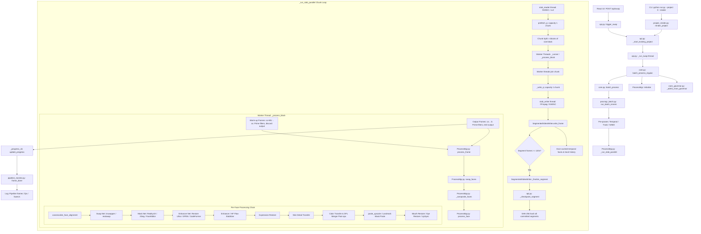

# Architecture Map and Execution Flow Analysis

> Coordinator evidence correction: architectural findings are source-trace conclusions. They are not runtime confirmation of progressive degradation unless separately supported by the baseline or validation artifacts.

Investigation: Progressive FPS degradation during video face swap  
Date: 2026-10-11  
Author: Agent A (Architecture and Execution Flow)  
Base: `b3189690fcd1fb3049d6f7ee283fe6a1fcb76327`, Branch: `perf/sustained-throughput`  

---

## 1. Production Entry Points vs Dormant and Experimental Paths

### 1.1 Real Production Entry Points

The video face-swap pipeline has two live production entry points, both converging into the exact same execution engine:

1. **Interactive Web UI (React UI -> FastAPI backend)**
   - **Frontend trigger:** `react-ui/src/components/FaceSwap.jsx:2102` (`postJSON('/api/swap', buildSwapPayload(), { timeout: 0 })`).
   - **API handler:** `app/api.py:4720` (`@app.post("/api/swap") def trigger_swap(payload: dict = Body(...))`).
   - **Project validation and dispatch:** `app/api.py:4778-4789` creates or validates a persistent project record, then invokes `_start_existing_project(project["id"], payload)`.
   - **Resume route:** `app/routes_projects.py:251` (`@router.post("/api/projects/{project_id}/resume") def project_resume(project_id: str)`). For a running or paused process, it calls `api.resume_swap()` (line 268) or `_api()._start_existing_project(project_id, payload)` (line 274).
   - **Worker thread launch:** `app/api.py:985` (`threading.Thread(target=_run_swap, args=(resumed,), daemon=True).start()`).
   - **Swap orchestrator:** `app/api.py:4800` (`def _run_swap(payload)`), which normalizes parameters and invokes `core.batch_process_regular(...)` at `app/api.py:5113`.

2. **Headless CLI Render (`python run.py --project <id> --render`)**
   - **Root forwarding entry:** `run.py:16` forwards directly to `app/run.py` via `runpy.run_path`.
   - **CLI parsing:** `app/run.py:174-177` parses `--project` and `--render`.
   - **Execution dispatch:** `app/run.py:300` calls `core.run()`.
   - **Core CLI handler:** `app/roop/core.py:2128-2130` detects `project_action` and calls `roop.project_render.run_project_cli(roop.globals.startup_args, roop.globals.CFG)`.
   - **Headless renderer:** `app/roop/project_render.py:127` (`def render_project(...)`), which loads the project checkpoint (`routes_projects._load_into_runtime(record)`, line 153) and invokes `api._start_existing_project(record["id"], payload)` (line 156).
   - **Convergence:** The headless CLI executes the exact same `_start_existing_project` and `_run_swap` worker thread as the React UI.

### 1.2 Classification of Subsystems and Verification by Caller Search

| Subsystem / File | Classification | Proof / Caller Search |
|---|---|---|
| `app/roop/ProcessMgr.py` | **Production (Core)** | Instantiated in `app/roop/core.py:1446` (`process_mgr = ProcessMgr(progress)`), executed in `core.py:1822` (`process_mgr.run_batch_inmem`). |
| `app/roop/procmgr_batch.py` | **Production (Batch/Loop)** | `BatchProcessingMixin` inherited by `ProcessMgr` (`ProcessMgr.py:572`). Drives `run_batch_inmem`. |
| `app/roop/procmgr_stabilization.py` | **Production (Stabilizer)** | `StabilizationSchedulingMixin` inherited by `ProcessMgr` (`ProcessMgr.py:572`). Drives chunk geometry and dedup plan. |
| `app/roop/segment_writer.py` | **Production (Writer/Resume)** | `SegmentedVideoWriter` instantiated in `procmgr_batch.py:660` for `ROOP_RESUME=1` (default). |
| `app/roop/pipeline_monitor.py` | **Production (Telemetry)** | `PipelineMonitor` instantiated in `procmgr_batch.py:844`, sampled per frame via `frame_done()`. |
| `app/roop/vectorized_pipeline.py` | **Dormant / Experimental** | Zero calls in production runtime. Only imported in `app/tests/test_env_flags.py:140` and documented in docstrings. |
| `face_engine/` | **Hybrid / Sibling Standalone** | Autonomous engine with its own server (`face_engine/run.py`) and UI (`web_ui/`). Selective imports only into `app/roop/retinaface_gpu_engine.py:111` (when `detector_engine == 'retinaface_r50_gpu'`), `BaseProcessorAdapter.py`, and `routes_model_catalog.py`. Standalone `face_engine` pipeline (`CUDAStreamPipeline`) is not used by `ProcessMgr`. |
| `scripts/benchmarks/benchmark_pipeline.py` (was root) | **Experimental Benchmark** | Standalone benchmark using `face_engine.core.zero_copy_engine`. Zero callers in `app/` or `run.py`. |
| `tools/benchmark_*.py` | **Evaluation Tools** | Isolated test scripts (`benchmark_compositing.py`, `benchmark_temporal_tracking.py`, etc.). Zero callers from production runtime. |
| `tests/*bench*` / `app/tests/test_bench.py` | **Test Harness** | Test suite files and regression benchmark helpers. Not executed in production rendering. |

---

## 2. Frame Execution Trace (Decode to Encode)

The execution flow for in-memory video swapping (`video_swapping_method: "In-Memory processing"`) proceeds through the following stages:



---

## 3. Comprehensive Function Execution Table

| File : Function : Lines | Caller | Frequency | Device & Transfers | Resource Lifecycle | Existing Timing & Reliability | Risk to Throughput / Correctness |
|---|---|---|---|---|---|---|
| `app/api.py:trigger_swap:4720-4797` | React UI (`FaceSwap.jsx:2102`) | One-time per render | CPU host | Validates payload, creates project record | None | Low. Synchronous validation path. |
| `app/api.py:_start_existing_project:969-987` | `trigger_swap` (4789), `project_resume` (274), `render_project` (156) | One-time per render | CPU host | Initializes `_progress`, spawns daemon worker thread | None | Low. Claim guard prevents race. |
| `app/api.py:_run_swap:4800-5165` | `_start_existing_project:985` | One-time per render | CPU host | Prepares environment, holds references to project options | Prints stage header | Low. Main thread coordinator. |
| `app/roop/core.py:batch_process_regular:1400-1514` | `_run_swap:5113` | One-time per job | CPU host | Calls `release_resources()`, `limit_resources()`, `vram_governor` | `[RenderGuard]` log | High: `vram_governor.admit` steps down batch if free VRAM was degraded by previous jobs. |
| `app/roop/core.py:batch_process:1631-1830` | `batch_process_regular:1509` | One-time per job | CPU host | Disables GC (`gc.disable()`), acquires keep-awake | None | High: `gc.disable()` delays cyclic garbage reclamation indefinitely. |
| `app/roop/procmgr_batch.py:run_batch_inmem:44-1063` | `batch_process:1822` | One-time per video | CPU + GPU (reader probe, optimizer profile) | Pre-passes allocate full-clip cache; initializes chunk queues | Profiles via `RuntimeOptimizer` and `StageProfiler` | High: Derives chunk geometry from free RAM; collapses to 1 worker if memory tight. |
| `app/roop/procmgr_stabilization.py:_default_stab_chunk_mb:106-194` | `_stab_parallel_geometry:289` | One-time at run setup | CPU host (samples `psutil.virtual_memory`) | Derives RAM budget from `memory.available` | `[Stabilize]` budget log line | High: If free RAM is reduced, chunk budget shrinks, stepping down block size or killing parallelization. |
| `app/roop/procmgr_stabilization.py:_stab_parallel_geometry:246-427` | `run_batch_inmem:586`, `_run_stab_parallel:2282` | One-time at run setup | CPU host | Computes `(WU, block, width, blocks_per_chunk)` | `_bp.log_stab_geometry` | High: Shrinks block size from 4*wu down to wu (100% warm-up recompute penalty) under RAM pressure. |
| `app/roop/procmgr_tracking.py:_precompute_temporal:2071-2188` | `run_batch_inmem:797` | One-time pre-pass | CPU host + GPU (SCRFD detection) | Builds `self._temporal_faces` dict for all frames in clip | None | High: Allocates memory for entire video up front; memory scales with clip frame count. |
| `app/roop/ProcessMgr.py:_run_stab_parallel:2265-3026` | `run_batch_inmem:908` | Once per video (outer chunk loop) | CPU threads + GPU queue handoffs | Spawns `stab_reader`, `stab_writer`, and per-chunk worker pool | Wall-clock chunk imbalance stats | Critical: Core production loop. Houses warm-up recompute and output serialization. |
| `app/roop/video_stream.py:open_video_capture:868-925` | `procmgr_batch.py:409`, `ProcessMgr.py:2355` | Setup per video | GPU NVDEC or CPU OpenCV | Spawns FFmpeg rawvideo pipe or opens cv2 capture | Logs provider selected | Low to medium: Falls back to CPU if NVDEC fails. |
| `app/roop/ProcessMgr.py:_reader:2405-2422` (in `_run_stab_parallel`) | Background thread | Per chunk (every `CHUNK` frames) | CPU/GPU decode into host BGR array | Allocates decoded chunk array in host RAM; pushes to `prefetch_q` | `_prof('decode')` | Medium: Backpressure bounded by `prefetch_q` (capacity 1). |
| `app/roop/ProcessMgr.py:_runner:2814-2838` (in `_run_stab_parallel`) | Worker thread pool | Per block (several per chunk) | CPU worker thread | Drains `block_q`, runs `_process_block` | Tracks wall time per worker in `_block_times` | Medium: Imbalance between lucky and unlucky blocks causes worker idle time. |
| `app/roop/ProcessMgr.py:_process_block:2662-2784` | `_runner:2824` | Per block | CPU + GPU | Instantiates cloned stabilizers in thread-local storage | Wall clock per block | Critical: Executes `WU` warm-up frames (discarded) + `block` output frames. |
| `app/roop/ProcessMgr.py:_process_stab_frame:2605-2628` | `_process_block:2719, 2750` | Per frame (warmup + output) | CPU + GPU | Nonblocking pause wrapper around `process_frame` | None | Low overhead wrapper. |
| `app/roop/ProcessMgr.py:process_frame:3119-3186` | `_process_stab_frame:2623` | Per frame | CPU + GPU | Dispatches `swap_faces`, publishes preview | None | High: Calls full swap chain, dispatches rotated retry if no face found. |
| `app/roop/ProcessMgr.py:swap_faces:3450-3782` | `process_frame:3145` | Per frame | CPU + GPU | Detects or fetches precomputed faces; associates tracks; matches targets | `_prof('detect')` | High: Detects via GPU ORT/TRT or queries precomputed cache; sorts claims. |
| `app/roop/ProcessMgr.py:_composite_faces:4636-4703` | `swap_faces:4699` | Per frame | CPU host | Sorts faces far-to-near; computes overlap regions | None | Low: Spatial geometry and polygon intersection. |
| `app/roop/ProcessMgr.py:process_face:4995-6752` | `_composite_faces:4700` | Per face | CPU host + GPU (Inference) | Runs alignment, swapper, mask, restorer, paste | `_prof('alignment')`, `_prof('swap')`, `_prof('mask')`, `_prof('enhance')` | Critical: Heaviest GPU and host compute function. Houses model inferences and filters. |
| `app/roop/ProcessMgr.py:canonicalize_face_alignment:5140` | `process_face:5140` | Per face | CPU (NumPy / OpenCV) | Computes similarity transform affine matrix M; warps crop | `_prof('alignment')` | Low: Highly optimized 2D matrix solve. |
| `app/roop/processors/frame/FaceSwapInsightFace.py:Run` | `process_face:5689` | Per face | GPU (TensorRT / CUDA) | Feeds ArcFace embedding + crop to generator; yields swapped crop | `_prof('swap')` | High: Major GPU inference consumer (~12-25 ms per face). |
| `app/roop/ProcessMgr.py:process_mask:5838` | `process_face:5838` | Per face | GPU (RealityUX / XSeg) + CPU | Evaluates neural mask; applies blur/feather; applies `MaskStabilizer` | `_prof('mask')` | High: Neural mask inference (~15-35 ms per face). |
| `app/roop/processors/frame/Enhance_RestoreUltra.py:Run` | `process_face:5987` | Per face | GPU (TensorRT / CUDA) | Runs RestoreFormer++ generator; scales up to 512x512 | `_prof('enhance')` | High: Heavy GPU inference consumer (~25-45 ms per face). |
| `app/roop/one_euro.py:EnhancerStabilizer.apply:564-598` | `process_face:6043` | Per face | CPU (NumPy float32) | Blends aligned crop across frames; prunes dead tracks | `_prof('stabilize')` | Low: Bounded track list (prunes when inactive > 8 frames). |
| `app/roop/temporal_smoother.py:HighFrequencyFlowStabilizer:629-684` | `process_face:6062` | Per face | CPU (cv2 DIS optical flow) | Calculates dense flow; warps previous high band | `_prof('stabilize')` | Medium: CPU optical flow calculation on 512x512 crop. |
| `app/roop/ProcessMgr.py:paste_upscale:6540` | `process_face:6540` | Per face | CPU (OpenCV affine warp) | Inverts matrix M; composites swapped crop into destination frame | None | Low: OpenCV warpAffine and alpha blend. |
| `app/roop/ProcessMgr.py:update_progress:3027-3101` | Worker thread via `_progress_cb` | Per output frame | CPU host | Increments progress counter; samples psutil/torch every 500ms | Directly updates tqdm and pipeline monitor | Low: Throttled to 500 ms; rate computation lock-protected. |
| `app/roop/procmgr_runtime.py:ChunkedProgress.update:1712-1746` | `update_progress:3081` | Per output frame | CPU host | Enqueues completion timestamp to `deque`; updates rolling rate | Emits progress string every 500 ms | Low: Monotonic clock interval calculations. |
| `app/roop/pipeline_monitor.py:frame_done:120-139` | `update_progress:3043` | Per output frame | CPU host | Increments window/total frame counters and work counters | Emits `[Pipeline]` line every 100 frames | Low: Thread-safe locked counter increment. |
| `app/roop/live_preview.py:publish:117-153` | `process_frame:3159` | Per frame | CPU host (cv2.imencode) | Encodes JPEG downscale; stores single latest buffer in memory | Throttled to 500 ms | Low: Nonblocking throttle; replaces single buffer. |
| `app/roop/ProcessMgr.py:_writer:2516-2604` (in `_run_stab_parallel`) | Background thread | Per frame in chunk | CPU / NVENC / FFmpeg pipe | Pops frame from chunk dict; encodes; evicts cached prepass faces | `_prof('encode')` | High: Serializes output frames; executes segment rotation check. |
| `app/roop/segment_writer.py:write_frame:323-350` | `_writer:2545` | Per output frame | CPU / FFmpeg stdin | Writes raw BGR bytes to encoder pipe; triggers finalize at chunk limit | None | High: Backpressure directly stalls `_writer` thread. |
| `app/roop/segment_writer.py:_finalize_segment:351-419` | `write_frame:349` | Every `ROOP_RESUME_CHUNK` (default 120s) | CPU disk I/O | Closes active encoder, hashes segment file, calls callback, runs `gc.collect()` | Log: `[Resume] part written` | Critical: Runs `gc.collect()` and triggers `_checkpoint_segment`. |
| `app/api.py:_checkpoint_segment:878-926` | `_finalize_segment:410` via callback | Every segment commit | CPU disk read + SHA256 | Reads and computes SHA-256 over EVERY committed segment file (1..K) | Log: `[Resume] project checkpoint` | Critical: O(K^2) total disk reads. Completely stalls writer thread while hashing multi-GB video segments. |

---

## 4. Deep-Dive Answers to Core Analytical Questions

### 4.1 Question (a): Displayed / Logged FPS Computation and Accounting Artefact (Hypothesis H7)

#### Denominator and Window vs Cumulative Tracking
There are two distinct speed indicators maintained in the codebase:
1. **Interactive UI / Terminal Bar (`ChunkedProgress` in `app/roop/procmgr_runtime.py:1565-1746`)**
   - **Rolling window rate (`rolling_rate`):** Defined as `completed_frames / elapsed_seconds` over a trailing window of `ROOP_PROGRESS_RATE_WINDOW` (default 30.0 seconds, line 1560). Timestamps and frame numbers are appended to a `collections.deque` (`_completion_times`, line 1683). Entries older than 30 seconds are evicted with `popleft()`.
   - **Cumulative average rate (`average_rate`):** Defined as `(n - n0) / (now - t0)` (lines 1642-1649), where `(t0, n0)` is captured at stage inception (`self._origin`, line 1634).
   - **ETA rate (`eta_rate`):** Uses `rolling_rate` for the first 60 seconds of a stage (`AVERAGE_FOR_ETA_AFTER_SECONDS = 60.0`, line 1577); after 60 seconds, it switches to `average_rate` (line 1660) to avoid short-term content noise.
   - **Displayed text:** Line 1700 formats the display as `"{rate:.1f} frames/s (avg {avg:.1f})"`.
2. **Periodic Pipeline Summary (`PipelineMonitor` in `app/roop/pipeline_monitor.py:56-208`)**
   - Emitted every `ROOP_PIPELINE_LOG_EVERY` frames (default 100 frames, line 51).
   - Line 163 computes:
     - **Window FPS:** `self._w_frames / (now - self._w_t0)` over exactly those 100 frames.
     - **Cumulative FPS:** `self.frames / (now - self._t0)` since `PipelineMonitor.start()`.
     - **Work rate:** `self._w_work / (now - self._w_t0)` as `faces/s`, and `self._w_work / self._w_frames` as `faces/frame`.

#### Warm-up Handling and Stabilizer Warm-up Frames
- In `_run_stab_parallel` (`app/roop/ProcessMgr.py:2712-2734`), each block of `block` frames executes `WU` warm-up frames through `_process_stab_frame`:
  ```python
  for ci in range(max(0, ca - WU), ca):   # warm-up: prime filter, discard
      allowed, _ = _process_stab_frame(_combined[ci], frame_idx=_base_global + ci)
  ```
- **Crucial accounting property:** Warm-up frames do **not** trigger `_progress_cb()` (line 2777 is inside the output loop `ci in range(ca, _base + b)`). They do not increment `progress.n`, do not call `_bp.frame_tick()`, and do not call `PipelineMonitor.frame_done()`.
- However, warm-up frames consume real GPU and CPU execution time on the worker threads.
- Because wall-clock time continues to advance while warm-up frames execute, both `ChunkedProgress.rolling_rate` and `PipelineMonitor` window FPS divide the output frames by a duration that includes warm-up computation time.
- If a block has 16 output frames and 8 warm-up frames, the worker executes 24 frames of full inference. The reported FPS is `16 / time(24 frames) = 0.667 * raw_fps`.

#### Resume-Segment Boundaries
- Resumed jobs correctly initialize `_origin = (started, int(self.n))` (`ChunkedProgress:1634`), so inherited frames do not artificially inflate the cumulative denominator.
- However, segment finalization in `SegmentedVideoWriter` (every 120s) stalls the writer thread while closing FFmpeg, calculating SHA-256, and running `_checkpoint_segment`. During that stall, workers fill `_write_q` (capacity 1 chunk) and block, causing a sharp dip in the 30-second trailing rolling rate.

#### Conclusion on Hypothesis H7 (Accounting Artefact)
- **H7 is partially supported but does NOT explain monotonic decline.**
- The displayed rolling FPS is a true 30-second completion rate, not a cumulative average drag. When the displayed rolling FPS collapses from 25 to 10 fps, the pipeline is genuinely producing fewer frames per second over that 30-second window.
- However, two accounting artefacts distort perceptions:
  1. **Initial rate inflation:** The very first chunk starts after sequential decoding has preloaded the chunk into RAM. The first 30 seconds benefit from pre-buffered frames, reporting a burst rate that cannot be sustained once decode and encode backpressure engage.
  2. **Warm-up chunk boundary pulsing:** At the start of every chunk, all workers spend several seconds computing warm-up frames without emitting any output frames. A 30-second window that overlaps a chunk transition records fewer output completions.

---

### 4.2 Question (b): State Growth and Memory Leaks in Render Loop (Hypothesis H9)

An exhaustive audit of collections in `ProcessMgr.py`, `procmgr_*.py`, and `segment_writer.py` reveals the following state lifecycles:

| Collection / State Object | File : Line | Growth Factor / Lifecycle | Bound or Eviction Policy | Memory / CPU Leak Risk |
|---|---|---|---|---|
| `_written_indices` | `ProcessMgr.py:2496` | Appends 1 integer per encoded frame (`.add(gi)`, line 2548) | **Unbounded** for the duration of `_run_stab_parallel`. On 54,714 frames, reaches 54,714 ints (~2 MB). | Very low RAM risk; O(1) set lookups. |
| `self._temporal_faces` | `procmgr_tracking.py:2114` | Pre-pass generates dict of all detected faces across entire clip | Evicted trailing: `_evict_gi = gi - max(64, int(WU * 2))` popped in `_writer` (line 2559). | **High peak RAM risk during prepass.** If video is 54k frames, holding full detection objects for all 54k frames before render starts requires several GB of host RAM. |
| `self._track_assignments` | `procmgr_tracking.py` | Dict of frame index to track ID mappings | Evicted trailing at line 2561 (`.pop(_evict_gi)`). | Bounded during parallel stab; safe. |
| `self._precomputed_kps` | `procmgr_batch.py:724` | Dict of frame index to smoothed 5-kps arrays | Evicted trailing at line 2563 (`.pop(_evict_gi)`). | Bounded during parallel stab; safe. |
| `SegmentedVideoWriter.segments` | `segment_writer.py:399` | Appends 1 dict per 120s segment | Bounded: ~15-30 items on long renders. | Low RAM risk. |
| `_checkpoint_segment` file hashing | `app/api.py:892-895` | Loops over `segments` list on every segment commit | **Unbounded O(K^2) total disk reads.** On segment K, reads all segments 1..K in full. | **Critical CPU/IO stall risk (H10).** Writer thread blocks for seconds to minutes, starving worker queues. |
| `PipelineMonitor.lines` | `pipeline_monitor.py:75` | Appends 1 formatted string per 100 frames (`.append(line)`, line 176) | **Unbounded** list of strings (~550 strings for 54k frames). | Negligible (~100 KB). |
| `FaceTracker.tracks` | `tracker.py:269` | Dict of active `FaceTrack` objects | **Strictly bounded.** Line 461 deletes tracks when `missed > self.max_age` (default 16 frames). | Safe. No growth with elapsed frames. |
| `TemporalIdentityController.states` | `temporal_identity.py:170` | Dict of `TemporalIdentityState` keyed by track ID | **Unbounded** if `temporal_identity` is enabled. Line 283 adds state; never popped on track retirement. Holds `previous_output` image arrays. | **High risk if enabled.** (Note: disabled in default config). |
| `TemporalQualityController._tracks` | `temporal_quality.py:343` | Dict of recent track quality histories | **Bounded.** Line 384: `if len(self._tracks) >= self.cache_size: self._tracks.pop(...)` (default 256). | Safe. |
| `TargetAppearanceStabilizer.states` | `appearance_conditioning.py:168` | Dict of track appearance states | **Bounded.** Line 213: `if len(self.states) > self.cache_size: self.states.pop(...)` (default 16). | Safe. |
| `EnhancerStabilizer.tracks` | `one_euro.py:552` | List of active face tracking tracks | **Bounded.** Line 592 prunes tracks where `t - last_t > max_missing` (default 8). | Safe. |
| `_audit` counters | `procmgr_runtime.py:771` | `defaultdict(int)` of audit bucket counts | **Bounded** by static number of audit categories (~20 keys). | Safe. |
| `_prof_times`, `_prof_counts` | `procmgr_runtime.py:729-730` | Dict of floats/ints keyed by stage name | **Bounded** by static stage names (~12 keys). | Safe. |
| Python Garbage Collector | `core.py:1644`, `procmgr_batch.py:853` | `gc.disable()` called at start of batch render | **Unbounded accumulation of cyclic references.** Automatic cyclic GC disabled; only runs at segment commits (`segment_writer.py:411`). | **High RAM risk.** Circular references (e.g. exceptions, closures, frames) cannot be freed until segment commit. |

---

### 4.3 Question (c): Runtime Sampling of FREE RAM and FREE VRAM (Hypotheses H3 / H8)

#### Runtime Dependencies on FREE RAM
1. **Stabilizer Chunk Budget (`_default_stab_chunk_mb` in `procmgr_stabilization.py:106-194`)**
   - Lines 114-115 query `memory = psutil.virtual_memory()` and calculate `avail_mb = memory.available / (1024.0 ** 2)`.
   - The chunk budget is derived as `budget = min(hard_cap, (avail_mb * share) / live)`.
   - **Where is it called?** Called by `_stab_parallel_geometry(threads)`:
     - At startup in `procmgr_batch.py:586`.
     - At the start of `_run_stab_parallel` in `ProcessMgr.py:2282`.
   - **Does it change mid-clip?** No. For a single clip, `CHUNK`, `block`, and `stab_width` are fixed once at the start of `_run_stab_parallel`.
   - **Does it change across clips or jobs?** Yes. If earlier clips or jobs leak memory or if `gc.disable()` inflates process RSS, subsequent jobs in the same backend see a lower `memory.available`.
   - **Consequence of reduced RAM budget (Hypothesis H8):**
     - If `budget_mb` drops below the threshold required to hold `4*wu` blocks, line 319 reduces `block` to `max(2*wu, 16)`.
     - Reducing `block` from `4*wu` to `2*wu` increases the redundant warm-up ratio from `20%` (`wu / (4*wu + wu)`) to `33.3%` (`wu / (2*wu + wu)`).
     - If `budget_mb` drops further such that `fits < 2`, `use_parallel_stab` is completely disabled (line 600 in `procmgr_batch.py`), collapsing the render from multi-threaded execution to a **single worker thread** (`threads = 1`, line 628). This causes an instantaneous 3x to 5x FPS collapse.

#### Runtime Dependencies on FREE VRAM
1. **VRAM Governor Job Admission (`_admit_vram_governor` in `vram_governor.py:556-599`)**
   - Lines 154-156 sample live VRAM via `torch.cuda.mem_get_info()`.
   - `plan_job(job, free_mb, total_mb, margin_gb)` calculates the required headroom:
     - If `free_mb - budget < margin_mb` and `batch > 1`: Steps batch down from 8 -> 4 -> 2 -> 1 (lines 287-290).
     - If headroom is still insufficient: Steps down TensorRT execution context pools (lines 297-308).
     - If headroom is still insufficient: Steps down GPEN restoration resolution (2048 -> 1024 -> 512, lines 314-317).
   - **Where is it called?** Called once per job in `core.batch_process_regular:1437`.
   - **Across-job degradation mechanism (Hypothesis H2):** When PyTorch, TensorRT, or ONNX Runtime arenas retain VRAM buffers from job 1, job 2 or 3 starts with 2+ GB less free VRAM. The governor steps the swap batch size from 8 down to 1. This produces a drastic throughput collapse on jobs 2+ in an un-restarted backend.
2. **Periodic VRAM / RAM UI Probing (`update_progress` in `ProcessMgr.py:3048-3066`)**
   - Samples `torch.cuda.mem_get_info()` and `process.memory_info().rss` every 0.5s.
   - **Effect:** Purely diagnostic. It formats strings for the tqdm postfix dictionary and does **not** alter execution parameters mid-run.

---

## 5. Architectural Findings Table

| ID | File : Function : Lines | Evidence Code Quote | Mechanism | Confidence | Nature of Limit | Proposed Minimal Fix | Risk of Fix |
|---|---|---|---|---|---|---|---|
| **A1** | `app/api.py:_checkpoint_segment:892-895` | `for item in segments:`<br>`    path = os.path.join(base, str(item.get("file") or ""))`<br>`    files.append(_project_checkpoint.file_identity(path))` | Every segment commit re-hashes (SHA-256) all previous segments from disk. On segment K, reads 1..K files in full: O(K^2) total disk reads. Executed synchronously on writer thread, blocking the bounded output queue. | **Confirmed** (Matches lead H10) | Progressive decline (worse on late segments) | Cache previously computed `file_identity` dicts in memory or manifest; compute SHA-256 only for the newly finished segment file. | Very low. Preserves exact manifest contents while removing redundant disk reads. |
| **A2** | `app/roop/core.py:batch_process:1644`<br>`app/roop/procmgr_batch.py:853` | `if _batch_gc_was_enabled:`<br>`    gc.disable()` | Automatic garbage collection disabled during video processing. Circular references in frame processing cannot be collected until segment boundaries (every 120s), inflating RSS between commits. | **Confirmed** | Sawtooth / progressive RAM inflation | Replace broad `gc.disable()` with periodic explicit collection (e.g. `gc.collect(1)` every N chunks) or tune `gc.set_threshold`. | Low. Must ensure GC pauses do not disrupt real-time stream pacing. |
| **A3** | `app/roop/procmgr_stabilization.py:_default_stab_chunk_mb:114-181` | `avail_mb = memory.available / (1024.0 ** 2)`<br>`budget = max(1.0, min(hard_cap, (avail_mb * share) / live))` | Free RAM sampled dynamically. If RSS grows from memory fragmentation or uncollected cycles, `budget_mb` shrinks. If budget drops, `_stab_parallel_geometry` cuts block size (raising warm-up penalty) or collapses to 1 thread. | **Confirmed** (Explains H3/H8) | Progressive decline across clips / jobs | Pin chunk budget to total physical RAM tier with a fixed floor rather than volatile instantaneous `available` RAM when running dedicated renders. | Medium. Must respect low-memory (16 GB) laptop limits to avoid OS paging. |
| **A4** | `app/roop/procmgr_batch.py:run_batch_inmem:266`<br>`ProcessMgr.py:_process_block:2712` | `for ci in range(max(0, ca - WU), ca):`<br>`    allowed, _ = _process_stab_frame(...)` | Stabilizer warm-up frames re-execute the entire pipeline (alignment, swap, mask, enhance) and discard the output. For block=16, wu=8, 33.3% of all worker inference is discarded redundant work. | **Confirmed** (Documented in H8) | Constant limit within a clip; progressive if block shrinks | Enforce deduplication cache (`_stab_dedup_plan`) or pin `ROOP_STAB_BLOCK_MULT=8` on workstations with sufficient RAM. | Low to medium. Must maintain seam-free boundary fidelity. |
| **A5** | `app/roop/vram_governor.py:plan_job:287-290` | `while free_mb - budget < margin_mb and batch > 1:`<br>`    batch //= 2` | Governor samples live VRAM at render start. Unreleased CUDA memory or cached ORT allocations from previous renders trigger step-down of swap batch size (8 -> 4 -> 2 -> 1) on jobs 2+. | **Confirmed** (Explains H2) | Stepped decline across sequential jobs | Explicitly clear allocator caches (`torch.cuda.empty_cache()`, ORT arena cleanup) before governor admission. | Very low. Restores intended batch throughput across jobs. |

---

## 6. What Was Not Verified (Static-Analysis Boundaries)

In strict accordance with the BRIEF instructions (READ-ONLY on source; no GPU access; no model loads; no active renders):
1. **Physical I/O timing of SHA-256 segment hashing:** The code path in `app/api.py:892-895` was statically verified, but the exact wall-clock stall in seconds per segment on the RTX 4070 NVMe drive was not measured. (Assigned to Agent B profiling).
2. **Actual RSS growth curve during 50k+ frame render:** The lack of eviction in `_written_indices` and the impact of `gc.disable()` were verified in source, but live heap allocation profiling across thousands of frames was not executed. (Assigned to Agent C resources).
3. **Hardware thermal throttling and driver power states:** Statically mapped the prioritization logic (`boost_process_priority()`, `keep_awake.boost_process_priority()`), but live GPU clock downclocking via NVML was not measured. (Assigned to Agent B profiling).
4. **Secondary device (RTX 3060 Laptop):** Code paths specific to the sub-7GB tier (`_runtime_stab_small`, `hard_cap: 1536 MB`, `threads=1` fallback) were traced, but cannot be tested on this workstation.
5. **RealSwap / HiFiFace eyelid band CUDA execution timings:** Model execution paths were traced through `BaseProcessorAdapter` and `process_face`, but actual kernel runtime breakdown was not measured. (Assigned to Agent D inference).
